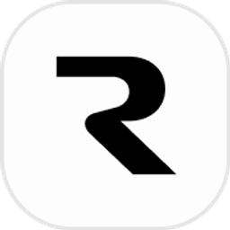
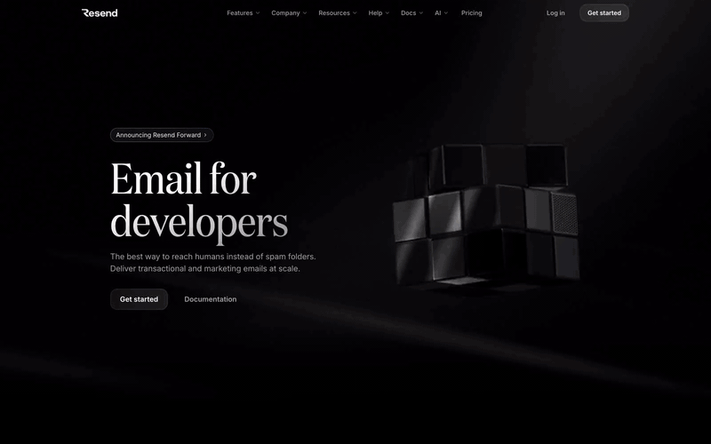

<div align="center">



# Resend — Front-End Clone

**Pixel-perfect front-end recreation of [resend.com](https://resend.com)**

[](https://resend-clone.space-z.ai)
[](https://nextjs.org)
[](https://www.typescriptlang.org)
[](https://tailwindcss.com)
[](https://bun.sh)

</div>

---

<div align="center">



> *[Live Demo](https://resend-clone.space-z.ai)*

</div>

---

## 📧 What is this?

A faithful front-end clone of **[Resend](https://resend.com)** — the developer-first email platform known for its clean dark aesthetic, animated 3D visuals, and interactive code demos. Built to sharpen UI cloning skills: extracting assets, reverse-engineering animations, reconstructing layouts section by section.

> This is a **front-end only** educational clone. No affiliation with Resend, Inc.

---

## ✨ What's Cloned

The site is reconstructed section by section from the original:

| Section | Description |
|---|---|
| **Hero** | Full-screen headline with animated 3D cube video and light-ray background |
| **Integrate** | Interactive SDK code tabs (Node.js, Python, Go, Ruby, PHP, CLI…) with framework switcher |
| **Developer Experience** | Live email send simulation with animated status responses |
| **Test Mode** | Webhook event log — bounce, deliver, complaint, click events |
| **Broadcast Editor** | Wysiwyg-style email editor mockup with toolbar and block inserter |
| **Contact Management** | Audience screenshot + broadcast analytics section |
| **React Email** | Live code editor with side-by-side email preview |
| **Deliverability** | 9-feature grid — BIMI, DMARC, dedicated IPs, blocklist tracking… |
| **Social Proof** | Infinite testimonial carousel from Vercel, Raycast, Gumroad, Replit… |
| **Dashboard** | Metrics panel with animated charts and deliverability scores |
| **Navigation** | Sticky top nav with mega-menu dropdowns |
| **Footer** | Full 5-column footer — Features, Resources, Company, Help, Community |

All local media — 3D `.mp4` animations, `.avif`/`.webp` backgrounds, `.svg` icons, and `.webp` avatars — are served from `/media/` and `/images/` with no external CDN dependencies.

---

## 🛠️ Tech Stack

| Layer | Technology |
|---|---|
| **Framework** | Next.js (App Router) |
| **Language** | TypeScript 5 |
| **Runtime** | Bun |
| **Styling** | Tailwind CSS v4 |
| **Components** | shadcn/ui · Radix UI |
| **Reverse Proxy** | Caddy (`Caddyfile` included) |

---

## 📁 Project Structure

```
Resend_Front-Clone/
├── src/
│   └── app/              # Next.js App Router pages & layouts
├── public/
│   ├── images/           # Cloned assets (logos, avatars, screenshots, icons)
│   └── media/            # 3D section videos (cube, integrate, broadcast, react, control)
├── Caddyfile             # Caddy reverse proxy config
├── tailwind.config.ts
├── next.config.ts
├── components.json       # shadcn/ui config
└── preview.gif
```

---

## ⚙️ Getting Started

### Prerequisites

- [Bun](https://bun.sh) ≥ 1.3
- Node.js ≥ 20

### 1. Clone & install

```bash
git clone https://github.com/islamMendjel/Resend_Front-Clone.git
cd Resend_Front-Clone
bun install
```

### 2. Run dev server

```bash
bun run dev
```

Open [http://localhost:3000](http://localhost:3000)

### 3. Build for production

```bash
bun run build
bun run start
```

### With Caddy (reverse proxy)

```bash
caddy run --config Caddyfile
```

---

## 🎯 Purpose

This project is a **UI cloning exercise** aimed at:

- Reverse-engineering production-grade marketing site layouts
- Matching 3D video transitions and animation timing exactly
- Practicing asset extraction and local serving
- Building pixel-accurate dark-theme interfaces with Tailwind v4
- Reconstructing interactive components (code editors, live demos, carousels)

---

## ⚠️ Disclaimer

This clone is built purely for **educational and skill-development purposes**.  
All design, copy, videos, and branding belong to [Resend, Inc.](https://resend.com)  
Not affiliated with or endorsed by Resend in any way.

---

<div align="center">

Built by [islamMendjel](https://github.com/islamMendjel) · Inspired by [resend.com](https://resend.com)

</div>
